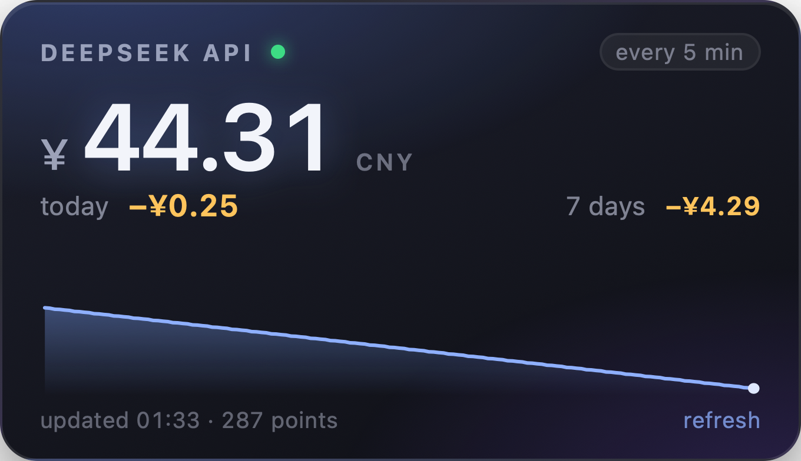

# DeepSeek Balance

A macOS desktop widget that shows your **DeepSeek API balance** and **how much you spent today**.
A small always-there card on your wallpaper — no dock icon, no menu bar clutter, no Electron.



- Balance straight from `GET /user/balance`, refreshed every 5 minutes (configurable).
- Today's spend, 7-day spend and a 24-hour balance sparkline, computed from balance deltas.
- Sits on the desktop, above your wallpaper and below normal windows. Drag it anywhere.
- Your API key lives in the **macOS Keychain** — never in a config file, never in logs.
- Universal binary (Apple Silicon + Intel), one Swift file's worth of dependencies: none.

## Install

Requires macOS 13 (Ventura) or newer and Xcode Command Line Tools
(`xcode-select --install` — Xcode itself is not needed).

```bash
git clone https://github.com/Mikage777/deepseek-balance-widget.git
cd deepseek-balance-widget
./install.sh
```

The script compiles the app, puts it in `~/Applications`, enables launch at login
(`--no-login-item` skips that) and starts it. On first run the widget asks for your
DeepSeek API key and stores it in the Keychain.

**Prebuilt app:** grab `DeepSeek-Balance-1.0.0.zip` from [Releases](https://github.com/Mikage777/deepseek-balance-widget/releases),
unzip, move to `/Applications`. It is ad-hoc signed, not notarized, so macOS will warn on
first launch — right-click → **Open**, or:

```bash
xattr -d com.apple.quarantine ~/Downloads/"DeepSeek Balance.app"
```

## Where the key comes from

Checked in this order, first hit wins:

1. **Keychain** — what the first-run dialog and the “Set API key…” menu item write
   (service `deepseek-balance-widget`, account `api-key`).
2. **Environment variable** `DEEPSEEK_API_KEY`.
3. **A `.env` file**, only if you set `env_file` in the config (e.g. `"env_file": "~/.env"`).

The key is sent to `api.deepseek.com` and nowhere else.

## How spend is calculated

DeepSeek's API exposes a balance but has **no usage or billing endpoint**. So the widget
polls the balance and treats every drop as spending:

- today's spend = sum of balance decreases between consecutive samples inside the local day;
- a balance **increase** is treated as a top-up — it does not reduce the spend, it just moves the baseline;
- accuracy equals the polling interval: a purchase becomes visible at the next poll (default 5 min);
- if the first sample of a day arrived later than 00:30, the card says `since HH:MM` — the day is only partly covered;
- with fewer than two samples the card shows `—`/`collecting` instead of a false `0.00`.

The 7-day figure needs a week of history to become meaningful (samples are kept for `keep_days`).
Treat the numbers as a close estimate, not as an invoice.

## Configuration

`~/Library/Application Support/DeepSeekBalance/config.json` — created on first run.
Menu (right click on the card) → **Open config.json**. Restart the app after editing.

| key | default | meaning |
|---|---|---|
| `refresh_seconds` | `300` | poll interval, minimum 15 |
| `currency` | `"CNY"` | which balance to show: `CNY` or `USD` |
| `locale` | `"en"` | interface language: `en` or `ru` |
| `title` | `"DEEPSEEK API"` | label in the card header |
| `width`, `height` | `340`, `196` | card size in points |
| `window_level` | `"desktop"` | `desktop` (under windows), `floating` (above everything), `normal` |
| `start_x`, `start_y` | — | initial position; default is the top-right corner of the main screen |
| `keep_days` | `30` | how many days of samples to keep |
| `spark_hours` | `24` | sparkline window |
| `api_key_env` | `"DEEPSEEK_API_KEY"` | env var name to look for |
| `env_file` | — | optional `.env` path, e.g. `"~/.env"` |
| `keychain_service`, `keychain_account` | `deepseek-balance-widget`, `api-key` | Keychain coordinates |

Chinese `¥` and US `$` balances are reported separately by DeepSeek; pick one with `currency`.

## Using the card

- **Drag** the top strip to move it; the position is remembered.
- Click **refresh** (bottom right) to poll immediately.
- **Right click** for the menu: refresh, set API key, open config, show data folder, hide for an hour, quit.

## Data and privacy

Everything stays on your machine:

| file | content |
|---|---|
| `~/Library/Application Support/DeepSeekBalance/state.json` | balances over time, card position |
| `.../config.json` | your settings |
| `.../widget.log` | poll results and errors (no key, ever) |

No telemetry, no analytics, no third-party requests — only `api.deepseek.com/user/balance`.

## Uninstall

```bash
./uninstall.sh           # app + login item, keeps history
./uninstall.sh --purge   # also deletes state and config
security delete-generic-password -s deepseek-balance-widget   # remove the stored key
```

## Development

```bash
./test.sh                                  # 42 checks: spend math, config, key resolution
./build.sh                                 # universal .app into dist/
./.build/tests                             # same suite, direct
dist/"DeepSeek Balance.app"/Contents/MacOS/DeepSeekBalance --print-payload   # what the card receives
dist/"DeepSeek Balance.app"/Contents/MacOS/DeepSeekBalance --snapshot /tmp/w.png --demo --locale ru
```

Layout lives in `src/widget.html`, the app in `src/main.swift`, the tested math in
`src/SpendLogic.swift`, `src/Config.swift`, `src/KeyStore.swift`. Tests are plain
`swiftc` binaries with no XCTest, so `./test.sh` works with Command Line Tools alone.

Under the hood: a borderless transparent `NSWindow` at desktop-icon level +1 (so clicks
reach the widget instead of Finder) hosting a `WKWebView`; data is injected with
`evaluateJavaScript`, never fetched from `file://`.

## License

MIT. Not affiliated with, endorsed by, or sponsored by DeepSeek.
