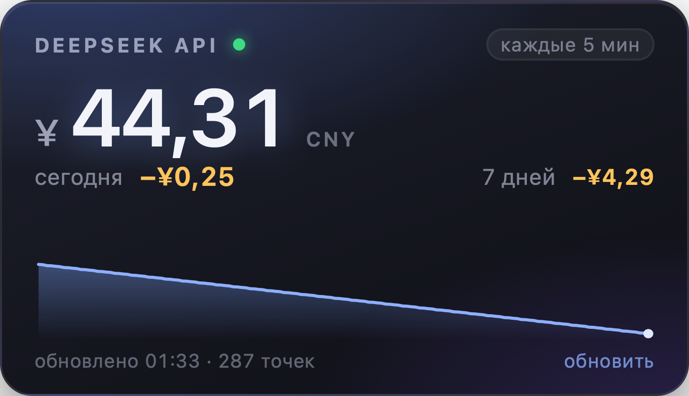

# DeepSeek Balance

Виджет рабочего стола macOS: **баланс DeepSeek API** и **сколько потрачено за сегодня**.
Маленькая карточка на обоях — без иконки в доке, без Electron, без меню-бара.



- Баланс напрямую из `GET /user/balance`, опрос каждые 5 минут (настраивается).
- Траты за сегодня, за 7 дней и спарклайн баланса за 24 часа — по дельтам баланса.
- Живёт на рабочем столе: над обоями, под обычными окнами. Перетаскивается за верхнюю полосу.
- Ключ API хранится в **Keychain macOS** — не в конфиге и не в логах.
- Universal-бинарь (Apple Silicon + Intel).

## Установка

Нужен macOS 13 (Ventura) или новее и Xcode Command Line Tools
(`xcode-select --install`, сам Xcode не нужен).

```bash
git clone https://github.com/Mikage777/deepseek-balance-widget.git
cd deepseek-balance-widget
./install.sh
```

Скрипт соберёт приложение, положит в `~/Applications`, включит автозапуск при входе
(`--no-login-item` — без него) и запустит. При первом запуске виджет спросит ключ
DeepSeek API и сохранит его в Keychain.

**Готовое приложение:** `DeepSeek-Balance-1.0.0.zip` из [Releases](https://github.com/Mikage777/deepseek-balance-widget/releases),
распаковать и перетащить в `/Applications`. Подпись ad-hoc, без нотаризации, поэтому macOS
предупредит при первом запуске — правый клик → **Открыть**, либо:

```bash
xattr -d com.apple.quarantine ~/Downloads/"DeepSeek Balance.app"
```

## Откуда берётся ключ

Проверяется по порядку, первое найденное побеждает:

1. **Keychain** — то, что пишут диалог первого запуска и пункт меню «Указать ключ API…»
   (service `deepseek-balance-widget`, account `api-key`).
2. **Переменная окружения** `DEEPSEEK_API_KEY`.
3. **Файл `.env`** — только если в конфиге задан `env_file` (например `"env_file": "~/.env"`).

Ключ уходит только на `api.deepseek.com`.

## Как считаются траты

У API DeepSeek есть баланс, но **нет эндпоинта расходов**. Поэтому виджет опрашивает баланс
и считает тратой каждое уменьшение:

- траты за сегодня = сумма падений баланса между соседними замерами внутри локальных суток;
- **рост** баланса считается пополнением — трат не уменьшает, просто сдвигает baseline;
- точность равна шагу опроса: покупка видна со следующего замера (по умолчанию через 5 минут);
- если первый замер дня пришёл позже 00:30, в карточке будет `с ЧЧ:ММ` — сутки покрыты не целиком;
- пока замеров меньше двух, вместо ложного `0.00` показывается `—` / «копим данные».

Цифра «7 дней» осмысленна только после недели истории (замеры хранятся `keep_days` дней).
Относитесь к числам как к близкой оценке, а не как к счёту от провайдера.

## Настройка

`~/Library/Application Support/DeepSeekBalance/config.json` — создаётся при первом запуске.
Правый клик по карточке → **Открыть config.json**. После правки приложение нужно перезапустить.

| ключ | по умолчанию | смысл |
|---|---|---|
| `refresh_seconds` | `300` | период опроса, минимум 15 |
| `currency` | `"CNY"` | какой баланс показывать: `CNY` или `USD` |
| `locale` | `"en"` | язык интерфейса: `en` или `ru` |
| `title` | `"DEEPSEEK API"` | заголовок карточки |
| `width`, `height` | `340`, `196` | размер карточки в точках |
| `window_level` | `"desktop"` | `desktop` (под окнами), `floating` (поверх всех), `normal` |
| `start_x`, `start_y` | — | стартовая позиция; по умолчанию правый верхний угол основного экрана |
| `keep_days` | `30` | сколько дней замеров хранить |
| `spark_hours` | `24` | окно спарклайна |
| `api_key_env` | `"DEEPSEEK_API_KEY"` | имя переменной окружения |
| `env_file` | — | путь к `.env`, например `"~/.env"` |
| `keychain_service`, `keychain_account` | `deepseek-balance-widget`, `api-key` | координаты в Keychain |

DeepSeek отдаёт юаневый `¥` и долларовый `$` балансы отдельно — какой показывать, решает `currency`.

## Управление

- **Перетаскивание** за верхнюю полосу (первые 30 px), позиция запоминается.
- Клик по **refresh** в правом нижнем углу — внеочередной опрос.
- **Правый клик** — меню: обновить, указать ключ API, открыть config, открыть папку данных,
  скрыть на час, выход.

## Данные и приватность

Всё остаётся на вашей машине:

| файл | содержимое |
|---|---|
| `~/Library/Application Support/DeepSeekBalance/state.json` | баланс по времени, позиция карточки |
| `.../config.json` | настройки |
| `.../widget.log` | результаты опросов и ошибки (ключа там нет) |

Ни телеметрии, ни аналитики, ни сторонних запросов — только `api.deepseek.com/user/balance`.

## Удаление

```bash
./uninstall.sh           # приложение + автозапуск, история остаётся
./uninstall.sh --purge   # плюс удалить состояние и настройки
security delete-generic-password -s deepseek-balance-widget   # удалить ключ из Keychain
```

## Разработка

```bash
./test.sh                                  # 42 проверки: математика трат, конфиг, поиск ключа
./build.sh                                 # universal .app в dist/
dist/"DeepSeek Balance.app"/Contents/MacOS/DeepSeekBalance --print-payload
dist/"DeepSeek Balance.app"/Contents/MacOS/DeepSeekBalance --snapshot /tmp/w.png --demo --locale ru
```

Вёрстка — `src/widget.html`, приложение — `src/main.swift`, покрытая тестами логика —
`src/SpendLogic.swift`, `src/Config.swift`, `src/KeyStore.swift`. Тесты — обычные
исполняемые файлы `swiftc` без XCTest, поэтому `./test.sh` работает на одних Command Line Tools.

Внутри: прозрачное borderless-окно `NSWindow` на уровне иконок рабочего стола +1
(иначе клики достаются Finder) с `WKWebView`; данные передаются через
`evaluateJavaScript`, а не читаются из `file://` — так надёжнее в WKWebView.

## Лицензия

MIT. Проект не связан с DeepSeek, не одобрен и не спонсируется ими.
